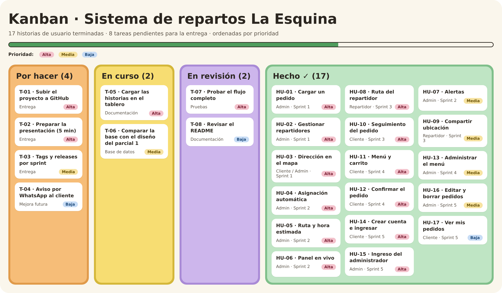

# La Esquina · Sistema de repartos

Sistema web (Django + MySQL) para un comercio con 2 o 3 repartidores propios: carga y asignación
automática de pedidos, ruta óptima con hora estimada, panel en vivo con mapa, app del repartidor,
seguimiento para el cliente y tienda online con cuentas.

Las historias de usuario están en el archivo `Historias_de_usuario.txt` y el tablero Kanban en `Kanban_La_Esquina.png`.



## Instalación
```
python -m venv venv
venv\Scripts\activate
pip install -r requirements.txt
```
Crear la base `test` en MySQL (usuario `root` sin contraseña, ver `sistema/settings.py`) y luego:
```
python manage.py migrate        # crea las tablas y el usuario admin / 123
python manage.py cargar_demo    # opcional: repartidores, menú y pedidos de ejemplo
python manage.py runserver
```
- Cliente: http://127.0.0.1:8000/
- Comercio: http://127.0.0.1:8000/panel (usuario `admin`, contraseña `123`)

## Arquitectura MVC
| Capa | Dónde |
|---|---|
| Modelo | `sistema/models.py` (+ migraciones en `sistema/migrations/`) |
| Vista | `sistema/templates/` (tienda, reparto, cuentas) |
| Controlador | `sistema/controllers/` (+ rutas en `sistema/urls.py`) |
| Lógica de negocio | `sistema/src/rutas.py` (asignación, ruta, ETA) y `sistema/src/permisos.py` |

La API JSON (`/api/...`) la consumen el panel, la app del repartidor y la página de seguimiento.


Ordena el reparto de un comercio con 2 o 3 repartidores propios: asigna cada pedido
automáticamente, calcula la ruta óptima y la hora estimada, y muestra todo en vivo
(panel del comercio, celular del cadete y página de seguimiento para el cliente).

## Cómo correrlo
```
venv\Scripts\activate
python manage.py migrate          # crea las tablas nuevas en MySQL (base "test")
python manage.py cargar_demo      # opcional: 3 repartidores + 8 pedidos de ejemplo
python manage.py runserver
```
Abrir http://127.0.0.1:8000/panel

## Pantallas
| URL | Para quién | Qué hace |
|---|---|---|
| `/panel` | Comercio | Mapa en vivo con cadetes y rutas, estado de cada envío, KPIs y alertas (toast + sonido + notificación del navegador) |
| `/pedidos` | Comercio | Carga del pedido (cliente, dirección ubicada en el mapa) → se asigna solo y da el link de seguimiento (copiar / WhatsApp) |
| `/repartidores` | Comercio | Alta de cadetes y turno (en turno / fuera de turno) |
| `/repartidor/<id>` | Cadete (celular) | Su ruta ordenada, "Salir a reparto", "Entregado", llamar / navegar, envío de GPS o simulación para la demo |
| `/seguimiento/<código>` | Cliente | Estado (preparación → en camino → entregado), hora estimada, cadete en el mapa y avisos. Así no llama |

## Cómo decide (sistema/src/rutas.py)
- **Distancia**: Haversine × factor urbano (1.35), velocidad 22 km/h + 3 min por entrega.
- **Ruta óptima** de cada cadete: vecino más cercano + mejora 2-opt.
- **Asignación**: el pedido va al cadete en turno cuya ruta, sumándolo, termina antes
  (combina cercanía y carga). Si ya está en la calle se cuenta que primero termina y vuelve al local.
- **ETA**: sale cuando el último pedido de su tanda está listo; se recalcula con cada GPS.
- **Alertas**: asignación, salida, entrega, sin repartidores y demora (+10 min sobre la ETA).

Los parámetros (ubicación del comercio, velocidad, etc.) están en `sistema/.env`.

## Archivos nuevos / cambiados
- `sistema/models.py` (Repartidor ampliado, Pedido, Notificacion) + `migrations/0003_reparto.py`
- `sistema/src/rutas.py`, `sistema/controllers/reparto_controller.py`, `sistema/urls.py`
- `sistema/templates/reparto/*`, `sistema/management/commands/cargar_demo.py`
- `settings.py`: idioma es-ar y zona horaria de Buenos Aires

## Vista del cliente (tienda online)
`http://127.0.0.1:8000/` es la tienda del restaurante:
1. El cliente ve el menú por categorías y arma el carrito (se guarda en su navegador).
2. "Continuar": carga nombre, teléfono y dirección (buscador, GPS o tocando el mapa).
3. Antes de confirmar ve **costo de envío, km y hora estimada de llegada**. Fuera de la zona de entrega no deja pedir.
4. Elige cómo paga (efectivo con "¿con cuánto pagás?", transferencia o tarjeta) y confirma.
5. El pedido entra solo al panel (🛒 web), se asigna repartidor y el cliente va directo a su página de seguimiento.
6. "Mis pedidos" (arriba a la derecha) guarda sus pedidos y muestra un aviso si tiene uno en curso.

La hora prometida en la tienda usa la misma decisión que la asignación real, así coincide con la que ve el cliente después.
El menú se administra en `/menu` (precios y "sin stock"). Envío y radio de entrega se configuran en `sistema/.env`.

## Cuentas (admin, clientes y repartidores)
- **Admin del comercio:** usuario `admin`, contraseña `123` (lo crea `python manage.py migrate`).
  Entra en `/ingresar` y va directo al panel. Panel, pedidos, repartidores, menú y sus APIs son solo para el admin.
- **Clientes:** se crean la cuenta en `/registro` (nombre, email, teléfono, contraseña) o entran en `/ingresar`
  con su email. Ven el menú sin cuenta, pero para confirmar hay que iniciar sesión (el carrito no se pierde).
  Sus datos y su última dirección quedan precargados y "Mis pedidos" sale de la cuenta.
- **Repartidores:** no usan usuario. Cada uno tiene un link secreto (`/repartidor/<id>?t=<clave>`) que se copia
  desde "Repartidores" y se le manda al celular. Solo ve su ruta y solo puede marcar sus pedidos.
- La página de seguimiento sigue siendo pública por código, para poder mandarle el link al cliente.
